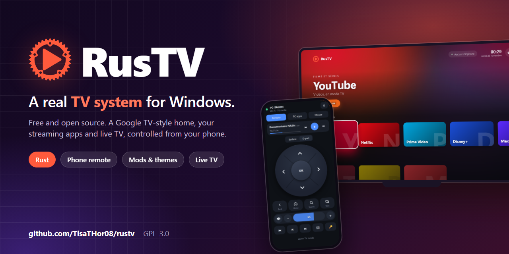
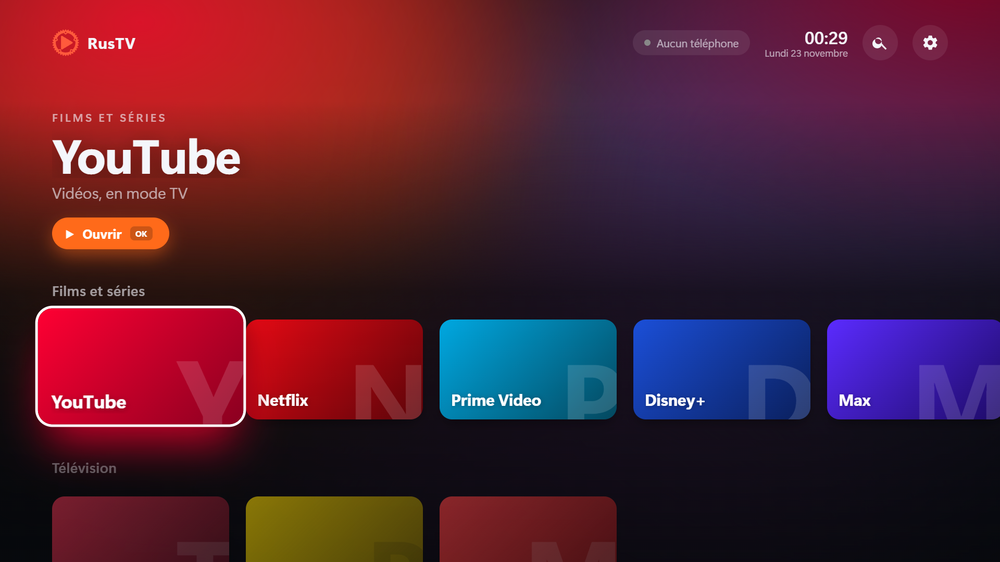
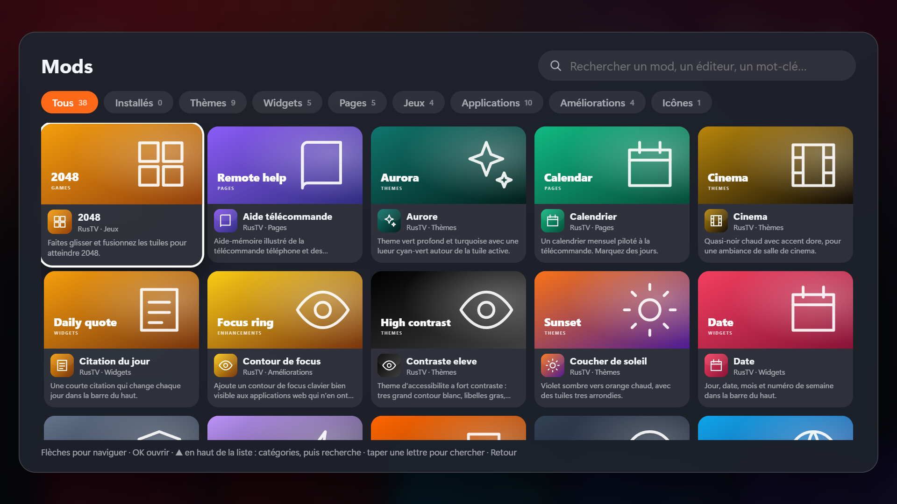
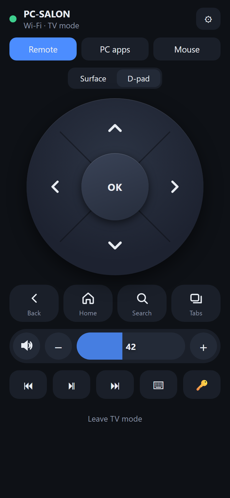
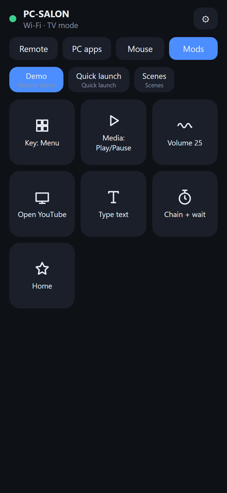
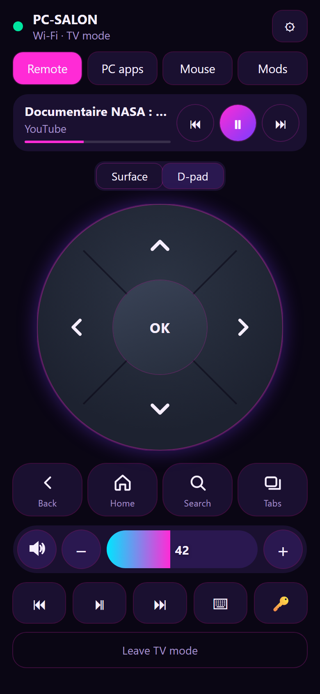
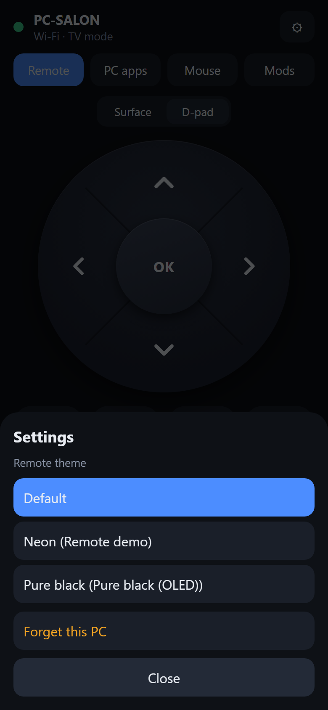

  

# RusTV

**Un vrai système TV pour Windows. Gratuit, open source, 100 % personnalisable, piloté depuis votre téléphone.**

RusTV transforme un PC Windows en TV connectée : écran d'accueil façon Google TV, applications de streaming
(YouTube, Netflix, Prime Video, Disney+, Plex, Jellyfin, UGREEN Theater…), TV en direct, médiathèque locale, et une appli
Android qui sert de télécommande. Tout est personnalisable et extensible par des **mods**.

> Version actuelle : **1.2.0**. Voir les [nouveautés](CHANGELOG.md), la [feuille de route](docs/ROADMAP.md) et
> l'[architecture](docs/ARCHITECTURE.md).

## Installer

1. Téléchargez l'installateur Windows et l'APK Android sur la
   [dernière version](https://github.com/TisaTHor08/rustv/releases/latest). L'installateur n'est pas signé :
   Windows SmartScreen peut afficher un avertissement.
2. Lancez RusTV, ouvrez la fenêtre « Téléphones » (icône de la zone de notification) et scannez le QR code avec l'appli.
3. Choisissez l'écran de la TV : les autres peuvent être masqués.

Le guide pas à pas (en anglais) est dans le [guide d'utilisation](docs/USER-GUIDE.md).

## Nouveautés de la 1.2.0

- **Démarrage sur la TV et garde TV** : RusTV démarre à l'ouverture de session directement en mode TV, empêche la mise en veille et
  empêche les autres fenêtres d'apparaître par-dessus.
- **TV en direct complète** : grille des programmes, enregistreur (DVR), tuners HDHomeRun et TVHeadend, pause et retour en direct.
- **Lecteur complet** : pistes audio et sous-titres, reprise, « Reprendre la lecture », file d'attente et épisode suivant.
- **Réception cast** (DIAL et DLNA), **ambilight Hyperion**, **Home Assistant** (MQTT).
- **Écran et son** : sortie audio, résolution, fréquence, HDR ; **manette** XInput.
- Interface adaptée aux écrans ultra-larges, 16:10, 4:3 et portrait.

## Nouveautés de la 1.1.0

- **Télécommande refaite** façon Google TV : anneau directionnel avec OK, boutons ronds Retour / Accueil / Recherche /
  Onglets, vibration à chaque appui.
- **Volume synchronisé** avec le PC : la barre de volume du téléphone suit Windows, et les boutons de volume du téléphone
  règlent le son du PC.
- **Sons de navigation** dans l'interface TV (désactivables).
- **Catalogue de mods refait** : catégories, recherche, installation et désinstallation, éditeur, dépendances, icône et
  bannière, note personnelle (stockée uniquement sur votre PC). 42 mods : thèmes, widgets, pages, jeux, packs de tuiles,
  améliorations de sites, icônes.
- **Mods pour la télécommande** : thèmes et panneaux de boutons (lancement rapide, scènes) fournis par des mods.
- **UGREEN Theater à distance** via UGREEN Link : connexion avec double authentification, bibliothèque et lecture vérifiées.
- Navigation aux flèches corrigée dans les applications web, saisie au clavier fidèle à la disposition de la fenêtre.

## Aperçu

  
  

  
  
  
  

## Aller plus loin

- [Applications prises en charge](docs/APPS.md) et leur état de test
- [Écrire des mods](docs/MODS.md) (thèmes, widgets, pages, adaptateurs, mods de télécommande)
- [UGREEN Theater](docs/UGREEN.md) · [Bitwarden](docs/BITWARDEN.md) · [Garde TV](docs/TV-GUARD.md) · [TV en direct](docs/LIVE-TV.md) · [Lecteur](docs/PLAYER.md) · [Cast](docs/CAST.md) · [Ambilight](docs/AMBILIGHT.md) · [Home Assistant](docs/HOME-ASSISTANT.md) · [Manette](docs/GAMEPAD.md) · [Écran et son](docs/DISPLAY-AUDIO.md)
- Le détail technique, la compilation et la contribution sont dans le [README principal](README.md).

Licence : [GPL-3.0-or-later](LICENSE) : les forks restent ouverts.
