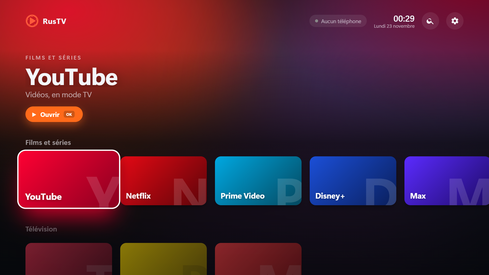
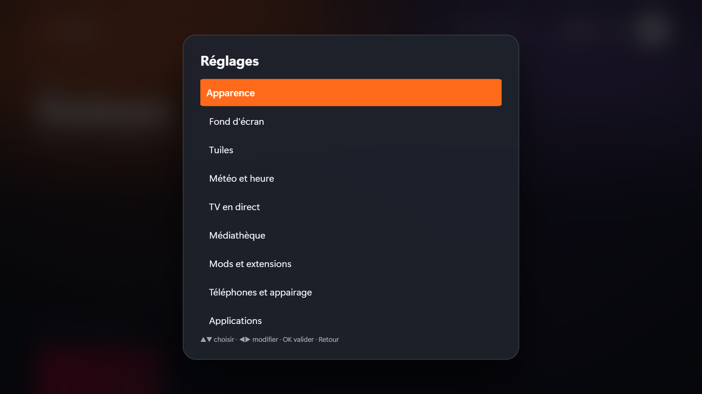
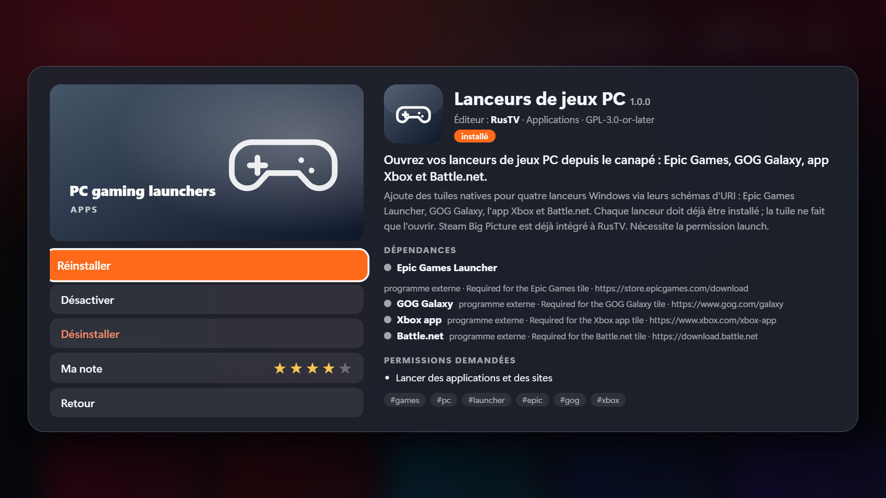
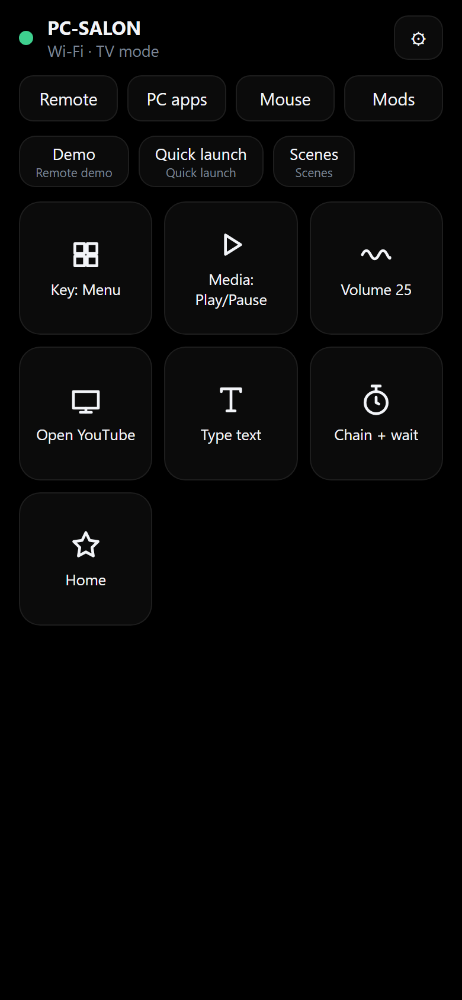

<p align="center">
  
</p>

# RusTV

**A real TV system for Windows. Free, open source, fully customizable, controlled from your phone.**

RusTV turns a Windows PC into a smart TV: a Google-TV/Apple-TV-style home screen, your streaming apps
(YouTube, Netflix, Prime Video, Disney+, Plex, Jellyfin, UGREEN Theater, …), VLC and Steam Big Picture,
and a phone app that works as the remote. It is built to be themed and extended with **mods**.

> Status: **v1.2.0**. TV mode with boot to TV, customization, mods and a mod store, complete live TV with DVR, a complete player, cast, ambilight, Home Assistant, game controller, Bitwarden, updates and a Google TV style phone remote.
> See the [changelog](CHANGELOG.md), the [roadmap](docs/ROADMAP.md) and the [architecture](docs/ARCHITECTURE.md).

<p align="center">
  
  
</p>
<p align="center">
  
  
  
</p>

<sub>Screenshots use demo data. The logo is derived from the Rust gear (CC-BY 4.0), see <a href="assets/LOGO-LICENSE.md">assets/LOGO-LICENSE.md</a>.</sub>

**Contents:** [What's new](#whats-new-in-v120) · [Install](#install) · [Gallery](#gallery) · [What works today](#what-works-today) ·
[Repository layout](#repository-layout) · [Build](#build) · [Testing](#testing) · [Documentation](#documentation) ·
[Contributing](#contributing) · [License](#license)

Français : [README.fr.md](README.fr.md)

## What's new in v1.1.0

- **Phone remote redesigned** in the Google TV style: four-way ring with OK, round Back, Home, Search and Tabs buttons, haptic feedback.
- **PC volume sync**: the phone's volume bar and hardware volume keys follow the Windows volume.
- **Mod store redesign**: categories, search, personal ratings (stored locally), install and uninstall, publisher, dependencies, icon and banner per mod. 42 mods in the repository.
- **Mods for the phone remote**: themes and button panels, declarative and sanitized.
- **Navigation sounds**, better **keyboard typing** (real key presses, layout of the focused window) and better arrow-key navigation in web apps.
- **UGREEN Link** remote access verified end to end, and a generated list of supported apps ([docs/APPS.md](docs/APPS.md)).

Everything else is in the [CHANGELOG](CHANGELOG.md).

## Install

Download from the [latest release](https://github.com/TisaTHor08/rustv/releases/latest):

1. **Windows**: run the installer (per-user, no administrator rights). It is not code-signed, so SmartScreen may warn: choose *More info*, then *Run anyway*.
2. **Android**: install the *RusTV Remote* APK from the same release. It is debug-signed: allow installing from unknown sources for your browser or file manager.
3. Start RusTV, accept the Windows Firewall prompt, scan the QR code with the phone.

**Linux (experimental, x86_64)**: `sudo apt install ./rustv_<version>_amd64.deb` (or run the AppImage), then log out and in once so the `/dev/uinput` permission applies. Only tested in Docker so far; gamepad, TV guard, display modes and HDR are not available. Read [docs/LINUX.md](docs/LINUX.md) first.

The step-by-step guide is [docs/USER-GUIDE.md](docs/USER-GUIDE.md).

## Gallery

<p align="center">
  
  
</p>
<p align="center">
  
  
  
</p>
<p align="center">
  
  
  
  
  
</p>

<sub>The phone remote themes and panels were verified with the real PC protocol and a browser rendering, not yet on a physical phone.</sub>

## What works today

- **TV mode** (Tauri + WebView2): pick the screen that is your TV (others can be blacked out),
  hero + rows home screen with focus parallax and shine, clock, phone status, settings.
- **Streaming apps** open full screen in their own WebView2 window with **one isolated profile per app**
  (sessions never mix). Widevine and PlayReady are available, so DRM services play inside RusTV.
  Sites without a TV mode get arrow-key **spatial navigation** injected.
- **YouTube with an ad blocker**: if Brave or Vivaldi is installed, YouTube opens there (full screen on the TV, dedicated profile) instead of WebView2; configurable in Settings > Apps.
- **Customization** (from the TV, with the remote): wallpapers (animated aurora, image, folder slideshow, looping
  video, blur and dim), dark/light/auto theme, accent color, French/English, optional weather, and tile editing
  (long-press OK on the phone: rename, recolor, set an icon, move, hide; add websites and Windows apps).
  Preferences live in `%APPDATA%\RusTV\prefs.json`.
- **Live TV and media**: your own M3U playlists and XMLTV guides (now/next, zapping with the remote), a local library of movies, shows, photos and music, a file explorer, Windows settings shortcuts and a universal search. Playback uses mpv, installed on demand after you agree (checksum verified). No channel list is bundled.
- **Bitwarden** ([docs/BITWARDEN.md](docs/BITWARDEN.md)): fill logins from your vault with one tap on the phone, using the official `bw` CLI (also works with Vaultwarden). Passwords never leave the PC except as injected keystrokes; auto-lock included.
- **Mods** ([docs/MODS.md](docs/MODS.md)): themes, tiles, full-screen pages, top-bar widgets, site adapters, icon sets and phone remote themes and panels, with declared and user-approved permissions, sandboxed execution and an in-app mod store (categories, search, local ratings, install and uninstall, dependencies) installing pinned GitHub commits.
- **UGREEN Theater** ([docs/UGREEN.md](docs/UGREEN.md)): local address or UGREEN Link remote access, verified with login, two-factor step and playback.
- **Navigation sounds** in the TV interface (synthesised, can be turned off or turned down).
- **Phone remote** (Svelte + Capacitor, Android): QR pairing, Google TV style ring remote (or a Siri-Remote-like swipe surface), haptic feedback, Back/Home/Search/Tabs, media keys,
  a volume bar synced with the PC volume (and the phone's volume keys), touchpad, a Mods tab for mod-provided button panels and themes,
  keyboard that pops up when a text field has focus on the PC, a *now playing* card (any app using Windows media controls, plus the RusTV player) and a search button.
- **Security**: HMAC-SHA256 challenge-response (the secret never travels), AES-256-GCM encrypted
  frames with anti-replay counters, per-phone revocable pairing, no Internet needed, no telemetry.
  See [docs/PROTOCOL.md](docs/PROTOCOL.md).

## Repository layout

| Path | Content |
| --- | --- |
| `crates/rustv-protocol` | Wire protocol: framing, handshake, encryption, messages (Rust) |
| `crates/rustv-core` | Remote server, input injection, pairing, Bluetooth, text-field detection, Windows volume, Bitwarden (Rust) |
| `crates/rustv-shell` | The `rustv.exe` application: Tauri shell, windows, tray, app catalog |
| `ui/` | TV interface (Svelte): home, screen picker, pairing |
| `mods/` | The mods of the catalog (themes, widgets, pages, games, tile packs, enhancements, phone remote) |
| `registry/` | Community mod catalog (`index.json`, format v2) |
| `scripts/` | `mods-tool.py` (validate mods, generate art and catalog), `gen-apps-doc.py` (generates docs/APPS.md) |
| `remote/` | Phone app (Svelte + Capacitor); protocol re-implemented in TypeScript |
| `assets/` | Logo and banner |
| `docs/` | User guide, architecture, protocol, mods, roadmap |

## Build

Requirements: Rust (stable, MSVC), Node 22+, WebView2 runtime (included in Windows 11), Android Studio for the APK.

```
cargo test -p rustv-protocol

cd ui && npm install && npm run build && cd ..
cargo build --release -p rustv-shell          # target/release/rustv.exe

cd remote
npm install && npm run build && npx cap sync android
npx cap open android                          # Build > Build APK
```

Run `rustv.exe` (tray icon, pair a phone) or `rustv.exe --tv [--screen N]` to start directly in TV mode.
On first launch Windows Firewall asks to allow RusTV on your network: accept, otherwise the phone cannot connect over Wi-Fi.

## Testing

- `node remote/scripts/e2e.ts <ip:port> <deviceId> <keyBase64>`: TypeScript client against the Rust core.
- `node remote/scripts/send.ts …`: send phone messages by hand. `remote/scripts/cdp.mjs`: drive and screenshot the TV UI
  through WebView2's debugging port (`WEBVIEW2_ADDITIONAL_BROWSER_ARGUMENTS=--remote-debugging-port=9222`).

## Documentation

The full index is in [docs/README.md](docs/README.md).

- Using RusTV: [user guide](docs/USER-GUIDE.md), [supported apps](docs/APPS.md), [UGREEN Theater](docs/UGREEN.md), [Bitwarden](docs/BITWARDEN.md), [changelog](CHANGELOG.md).
- Extending RusTV: [writing mods](docs/MODS.md), [development guide](docs/DEVELOPMENT.md), [architecture](docs/ARCHITECTURE.md), [protocol](docs/PROTOCOL.md), [roadmap](docs/ROADMAP.md).

## Contributing

Issues and pull requests are welcome. RusTV is, and will stay, free and open source.
Start with [CONTRIBUTING.md](CONTRIBUTING.md) and [docs/DEVELOPMENT.md](docs/DEVELOPMENT.md), and look at the
"Help wanted" section of the [roadmap](docs/ROADMAP.md) for good first issues. Please follow the
[Code of Conduct](CODE_OF_CONDUCT.md); report vulnerabilities privately as described in [SECURITY.md](SECURITY.md).

## License

[GPL-3.0-or-later](LICENSE). Forks must remain open source too. Streaming service names belong to their owners;
RusTV only opens their official websites and is not affiliated with them.
