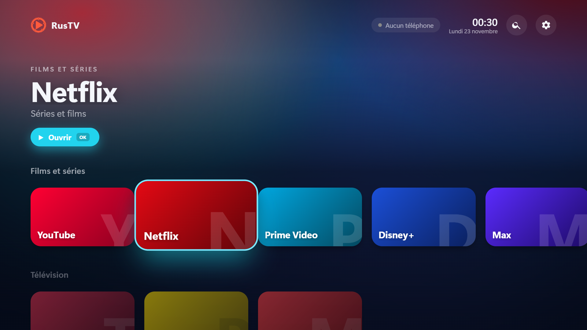
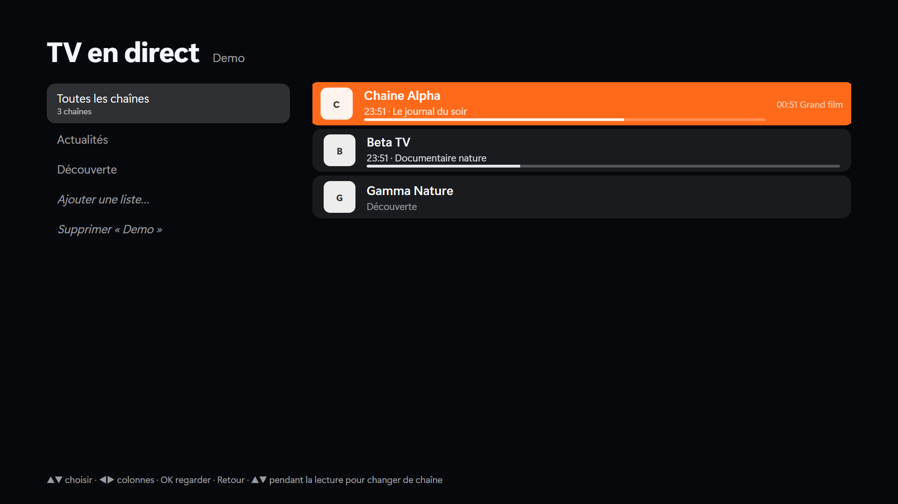
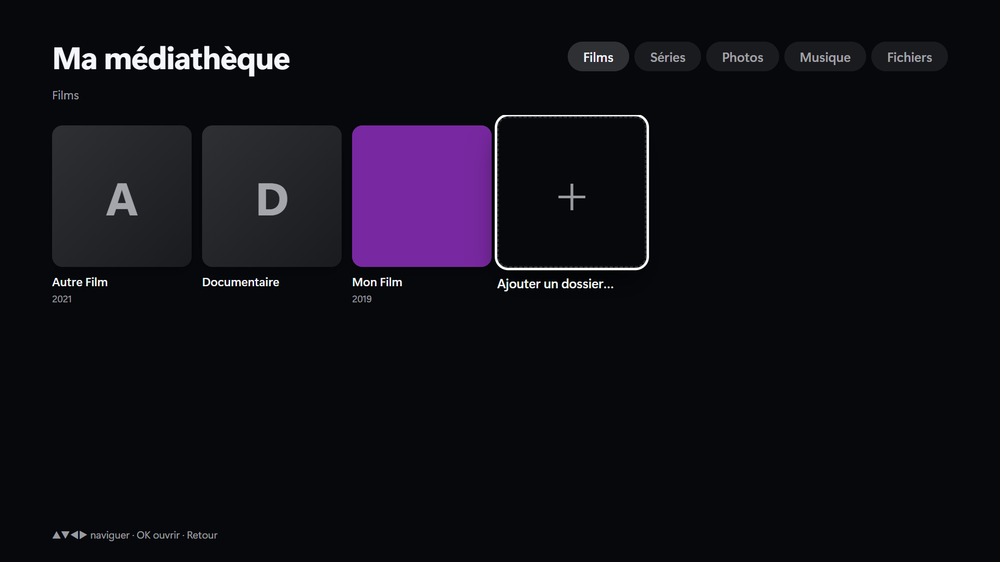
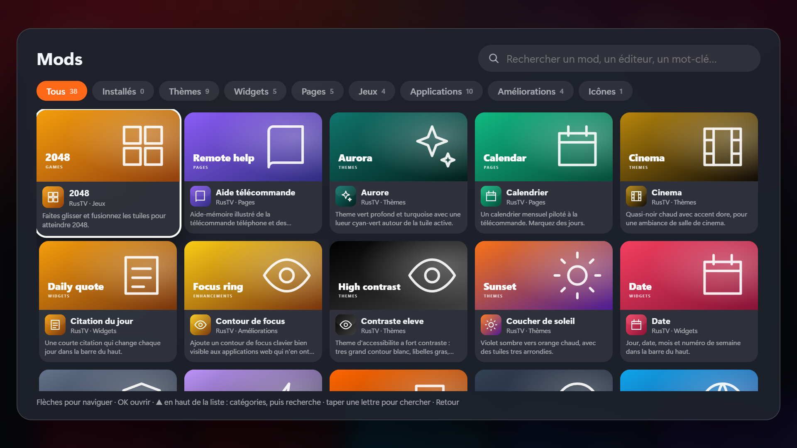

# RusTV

**A real TV system for Windows. Free, open source, fully customizable, controlled from your phone.**

RusTV turns a Windows PC into a smart TV: a Google-TV/Apple-TV-style home screen, your streaming apps
(YouTube, Netflix, Prime Video, Disney+, Plex, Jellyfin, UGREEN Theater, …), VLC and Steam Big Picture,
and a phone app that works as the remote. It is built to be themed and extended with **mods**.

> Status: **v1.0** (TV mode, customization, mods, live TV and library, updates). See the [roadmap](docs/ROADMAP.md) and the [architecture](docs/ARCHITECTURE.md).

<p align="center">
  
  
</p>
<p align="center">
  
  
  
</p>

<sub>Screenshots use demo data. The logo is derived from the Rust gear (CC-BY 4.0), see <a href="assets/LOGO-LICENSE.md">assets/LOGO-LICENSE.md</a>.</sub>

**Contents:** [What works today](#what-works-today) · [Repository layout](#repository-layout) · [Build](#build) ·
[Testing](#testing) · [Documentation](#documentation) · [Contributing](#contributing) · [License](#license)

Français : [README.fr.md](README.fr.md)

## What works today

- **TV mode** (Tauri + WebView2): pick the screen that is your TV (others can be blacked out),
  hero + rows home screen with focus parallax and shine, clock, phone status, settings.
- **Streaming apps** open full screen in their own WebView2 window with **one isolated profile per app**
  (sessions never mix). Widevine and PlayReady are available, so DRM services play inside RusTV.
  Sites without a TV mode get arrow-key **spatial navigation** injected.
- **YouTube with an ad blocker**: if Brave or Vivaldi is installed, YouTube opens there (full screen on the TV, dedicated profile) instead of WebView2; configurable in Settings > Apps.
- **Customization** (from the TV, with the remote): wallpapers (animated aurora, image, folder slideshow, looping
  video, blur and dim), dark/light/auto theme, accent color, French/English, optional weather, and tile editing
  (long-press OK on the phone: rename, recolor, set an icon, move, hide; add websites and Windows apps).
  Preferences live in `%APPDATA%\RusTV\prefs.json`.
- **Live TV and media**: your own M3U playlists and XMLTV guides (now/next, zapping with the remote), a local library of movies, shows, photos and music, a file explorer, Windows settings shortcuts and a universal search. Playback uses mpv, installed on demand after you agree (checksum verified). No channel list is bundled.
- **Bitwarden** ([docs/BITWARDEN.md](docs/BITWARDEN.md)): fill logins from your vault with one tap on the phone, using the official `bw` CLI (also works with Vaultwarden). Passwords never leave the PC except as injected keystrokes; auto-lock included.
- **Mods** ([docs/MODS.md](docs/MODS.md)): themes, tiles, full-screen pages, top-bar widgets and site adapters, with declared and user-approved permissions, sandboxed execution and an in-app catalog installing pinned GitHub commits.
- **Phone remote** (Svelte + Capacitor, Android): QR pairing, Siri-Remote-like swipe surface with haptic
  ticks and inertia, classic D-pad, Back/Home, tab switching, media keys + volume, touchpad,
  keyboard that pops up when a text field has focus on the PC, a *now playing* card (any app using Windows media controls, plus the RusTV player) and a search button.
- **Security**: HMAC-SHA256 challenge-response (the secret never travels), AES-256-GCM encrypted
  frames with anti-replay counters, per-phone revocable pairing, no Internet needed, no telemetry.
  See [docs/PROTOCOL.md](docs/PROTOCOL.md).

## Repository layout

| Path | Content |
| --- | --- |
| `crates/rustv-protocol` | Wire protocol: framing, handshake, encryption, messages (Rust) |
| `crates/rustv-core` | Remote server, input injection, pairing, Bluetooth, text-field detection (Rust) |
| `crates/rustv-shell` | The `rustv.exe` application: Tauri shell, windows, tray, app catalog |
| `ui/` | TV interface (Svelte): home, screen picker, pairing |
| `mods/` | Example mods |
| `registry/` | Community mod catalog (`index.json`) |
| `remote/` | Phone app (Svelte + Capacitor); protocol re-implemented in TypeScript |
| `assets/` | Logo |
| `docs/` | Architecture, protocol, roadmap |

## Build

Requirements: Rust (stable, MSVC), Node 22+, WebView2 runtime (included in Windows 11), Android Studio for the APK.

```
cargo test -p rustv-protocol

cd ui && npm install && npm run build && cd ..
cargo build --release -p rustv-shell          # target/release/rustv.exe

cd remote
npm install && npm run build && npx cap sync android
npx cap open android                          # Build > Build APK
```

Run `rustv.exe` (tray icon, pair a phone) or `rustv.exe --tv [--screen N]` to start directly in TV mode.
On first launch Windows Firewall asks to allow RusTV on your network: accept, otherwise the phone cannot connect over Wi-Fi.

## Testing

- `node remote/scripts/e2e.ts <ip:port> <deviceId> <keyBase64>`: TypeScript client against the Rust core.
- `node remote/scripts/send.ts …`: send phone messages by hand. `remote/scripts/cdp.mjs`: drive and screenshot the TV UI
  through WebView2's debugging port (`WEBVIEW2_ADDITIONAL_BROWSER_ARGUMENTS=--remote-debugging-port=9222`).

## Documentation

The full index is in [docs/README.md](docs/README.md):
[development guide](docs/DEVELOPMENT.md), [architecture](docs/ARCHITECTURE.md), [protocol](docs/PROTOCOL.md),
[writing mods](docs/MODS.md), [roadmap](docs/ROADMAP.md).

## Contributing

Issues and pull requests are welcome. RusTV is, and will stay, free and open source.
Start with [CONTRIBUTING.md](CONTRIBUTING.md) and [docs/DEVELOPMENT.md](docs/DEVELOPMENT.md), and look at the
"Help wanted" section of the [roadmap](docs/ROADMAP.md) for good first issues. Please follow the
[Code of Conduct](CODE_OF_CONDUCT.md); report vulnerabilities privately as described in [SECURITY.md](SECURITY.md).

## License

[GPL-3.0-or-later](LICENSE). Forks must remain open source too. Streaming service names belong to their owners;
RusTV only opens their official websites and is not affiliated with them.
