# RusTV user guide

RusTV turns a Windows PC into a TV: a big-screen home screen, your streaming apps, live TV and your own library, all
controlled from an Android phone. It is free, open source and has no telemetry.

This guide is for people who just want to use it. Developers should start with [DEVELOPMENT.md](DEVELOPMENT.md).

  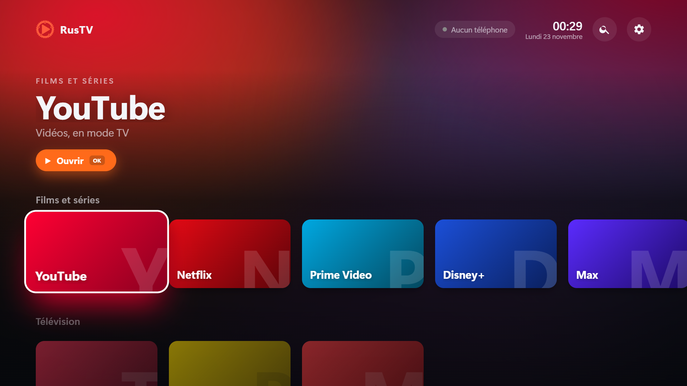

**Contents:** [Requirements](#requirements) · [Install](#install) · [First run](#first-run) ·
[Pair your phone](#pair-your-phone) · [Choose the TV screen](#choose-the-tv-screen) · [Use the remote](#use-the-remote) ·
[Apps and tiles](#apps-and-tiles) · [Live TV and library](#live-tv-and-library) · [YouTube without ads](#youtube-without-ads) ·
[UGREEN Theater](#ugreen-theater) · [Bitwarden](#bitwarden) · [Mods](#mods) · [Phone remote mods](#phone-remote-mods) ·
[Settings](#settings) · [Updates](#updates) · [Privacy](#privacy) · [Troubleshooting](#troubleshooting) · [Uninstall](#uninstall)

## Requirements

- A Windows PC (Windows 11 recommended; Windows 10 works if the WebView2 runtime is installed, it is included in Windows 11).
- An Android phone for the remote. RusTV can run without it, but you will want it to navigate.
- The PC and the phone on the same Wi-Fi network. Bluetooth is available as a fallback.
- A TV or monitor connected to the PC.
- Internet for streaming apps. RusTV itself works offline.

## Install

Everything is on the latest release page: <https://github.com/TisaTHor08/rustv/releases/latest>

1. **On the PC**, download the Windows installer from the release and run it. It installs for your user only (no
   administrator rights needed).
2. **On the phone**, download the Android APK (RusTV Remote) from the same release page and open it.

Two things to know:

- The Windows installer is **not code-signed**, so Windows SmartScreen may show "Windows protected your PC". Click
  **More info**, then **Run anyway**.
- The APK is **debug-signed** (not from the Play Store). Android asks you to allow installing from unknown sources for the
  app you used to download it (browser or file manager). Allow it for that app, then install.

## First run

Start RusTV from the Start menu. An icon appears in the notification area (system tray).

On first launch, **Windows Firewall asks to allow RusTV on your network. Accept**, otherwise the phone cannot reach the PC over
Wi-Fi.

From the tray icon you can pair a phone or start TV mode. You can also launch it directly in TV mode with
`rustv.exe --tv` (optionally `--screen N`), and make RusTV start with Windows in Settings.

## Pair your phone

1. On the PC, open the tray icon and choose **Phones**. In TV mode the same screen is in Settings, **Phones & pairing**.
   A QR code appears.
2. On the phone, open **RusTV Remote**, tap **Scan the QR code** and accept the camera permission.
3. Tap **Activate**. The remote connects and shows the PC name.

Each phone has its own secret key. In **Phones & pairing** you can create a new QR code or **revoke** a phone (press OK twice).
The phone tries the last known address, a discovery beacon on the local network, the addresses in the QR code and Bluetooth,
and uses the first path that authenticates.

## Choose the TV screen

When TV mode starts, RusTV asks which screen is your TV: move to it and press OK. The other screens can be **blacked out**
(Settings, Screens & startup, "Black out the other screens"). Use "Change screen" in the same place to move the TV
later, and "Leave TV mode" or "Quit RusTV" to stop.

## Use the remote

  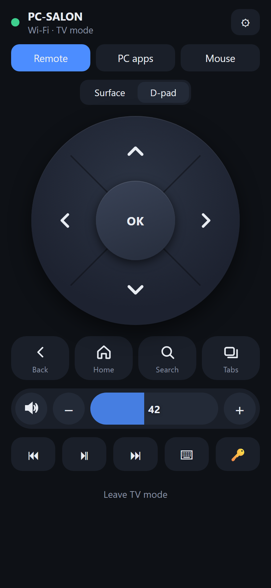
  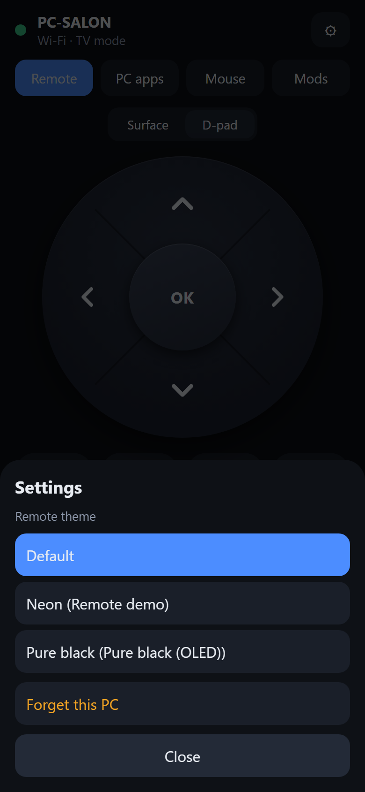

The **Remote** tab, from top to bottom:

| Control | What it does |
| --- | --- |
| Now playing card | Appears when something plays on the PC (any app using Windows media controls, or the RusTV player): title, progress, previous, play/pause, next |
| Start TV mode | Shown when TV mode is not running |
| Ring / Surface switch | Choose how you navigate |
| Ring (default) | Up, down, left, right and the **OK** button in the middle |
| Surface | Swipe to navigate, tap to select, hold for options (like a Siri Remote) |
| Back, Home, Search, Tabs | Round buttons. Holding Back sends a long Back. Tabs opens the Windows window switcher, then use Tab left, Tab right and Confirm |
| Volume | A bar that follows the PC volume and mute. The phone's hardware volume keys also change the PC volume |
| Media row | Previous, play/pause, next, **keyboard**, **Bitwarden** |

Buttons give a small vibration (haptic feedback).

Other tabs:

- **PC apps**: your installed Windows apps, searchable; tap one to launch it.
- **Mouse**: a touchpad. Drag to move, tap to click, two fingers for right click and scroll, plus left and right click
  buttons. Use it for sites that do not work with arrows.
- **Mods**: only visible when an enabled mod adds button panels. See [Phone remote mods](#phone-remote-mods).

**Keyboard.** When a text field has focus on the PC, the phone keyboard pops up; type there and the text goes to the PC. You
can also open it by hand with the keyboard button. Typing uses real key presses and the keyboard layout of the focused
window, so accents come out as expected.

**Remote settings.** The gear at the top right lets you choose a remote theme (the default, or one added by a mod) or
forget this PC.

The phone app is available in French and English, following the phone's language.

## Apps and tiles

The home screen has a hero banner and rows of tiles by category (movies and shows, television, music, library, games).
RusTV ships **42 app tiles**; each opens the real service in its own window with its own saved profile, so you sign in once
and sessions never mix. See [APPS.md](APPS.md) for the full list and how well each one is tested.

Honest status: YouTube and UGREEN Theater were checked end to end. Netflix, Prime Video and most other streaming apps need an
account and have **not** been tested yet. They should work; please report what you find.

**Customize a tile.** Highlight it and long-press OK on the phone (in surface mode: hold). The menu offers: open, rename,
color, choose an icon, move, hide, delete or reset. In Settings, Tiles, you can add a website or a Windows app, choose the
category for new tiles, show hidden tiles and reset everything. Preferences live in `%APPDATA%\RusTV\prefs.json`.

**Look.** Settings, Appearance and Wallpaper: dark, light or automatic theme, accent color, 24 or 12-hour clock, wallpaper
(animated aurora, solid color, image, folder slideshow or looping video, with blur and darken), interface size, navigation
sounds and their volume, and optional weather (type a city).

  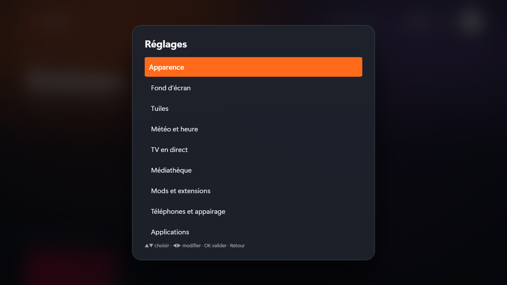
  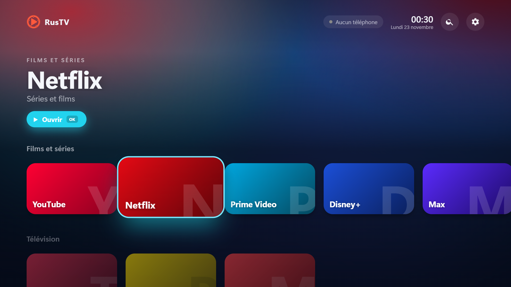

## Live TV and library

  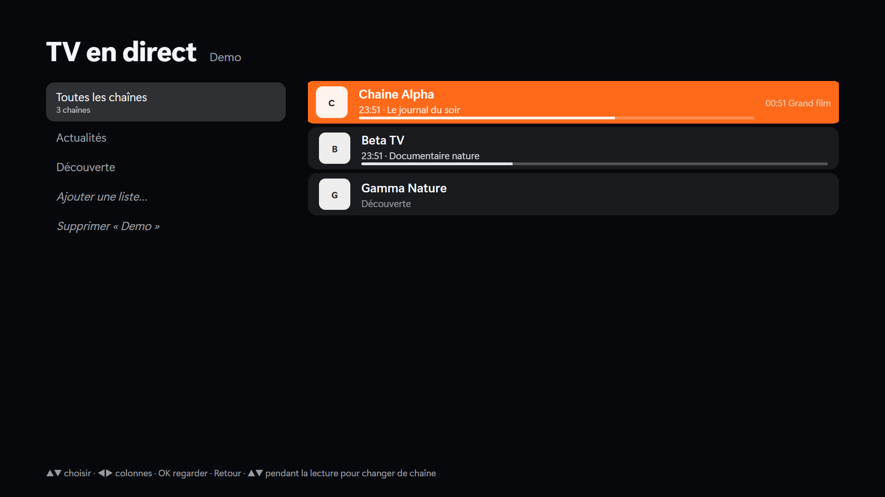
  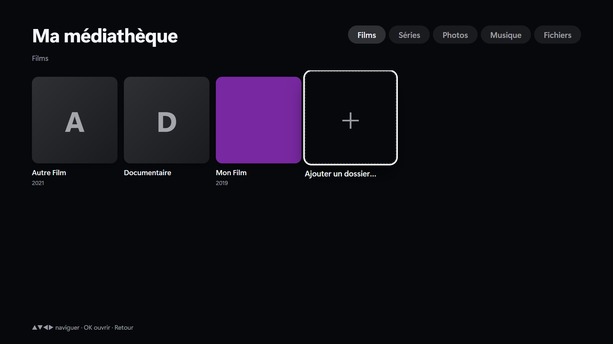

- **Live TV**: add the address of your own M3U playlist, and optionally an XMLTV guide (URL or file). You get now and next,
  and Up/Down zaps between channels while playing. RusTV bundles no channel list.
- **My library**: add folders of movies, shows, photos and music. Titles come from file names, shows are grouped by
  `SxxExx`, and `poster.jpg` or `folder.jpg` next to a file becomes its poster. Photos open in a viewer with slideshow.
- **Files**: browse your drives. **Search** (the Search button) looks across apps, channels and your library.
- Shortcuts for Wi-Fi, Bluetooth, Sound, Displays and Power open the matching Windows settings.

Video and music play in **mpv**. If mpv is not installed, RusTV asks first, then downloads it from GitHub (about 35 MB) and
verifies its checksum. Nothing is downloaded without your agreement.

## YouTube without ads

If **Brave** or **Vivaldi** is installed, the YouTube tile opens there in full screen on the TV, in a dedicated RusTV profile
(never your own). Brave blocks ads by default. In Vivaldi, turn its blocker on once in its settings. Choose the browser in
Settings, Apps, "YouTube: browser": Auto, Built-in window (no ad blocker), Brave or Vivaldi. The Home button on the remote
closes it and returns to the TV home.

## UGREEN Theater

The `ugreen` tile opens your UGREEN NAS (UGOS) in its own window. The first time, it asks for the address: a local one such
as `http://192.168.1.20:9999`, or a UGREEN Link address such as `https://my-nas.eur81.ug.link` for access from outside your
home. Log in once (the two-factor step included); the session is kept. Opening Theater and playing a film over UGREEN Link
was verified. For now, the phone's touchpad is the reliable way to press Play inside Theater. Details, ports and limits:
[UGREEN.md](UGREEN.md).

## Bitwarden

Fill passwords from your vault without typing them on a TV. Install the official CLI on the PC
(`winget install Bitwarden.CLI`), log in once from the phone's key button, then focus a login field on the PC, open the key
button, pick the login and tap **Fill**. Passwords never go to the phone: the PC types them, and only while the same window is
still focused. It also works with Vaultwarden. Full explanation and threat model: [BITWARDEN.md](BITWARDEN.md).

## Mods

Mods add themes, widgets, pages, games, tile packs, site enhancements, icon sets and phone remote features. They are small
folders with a manifest; see [MODS.md](MODS.md) if you want to write one.

  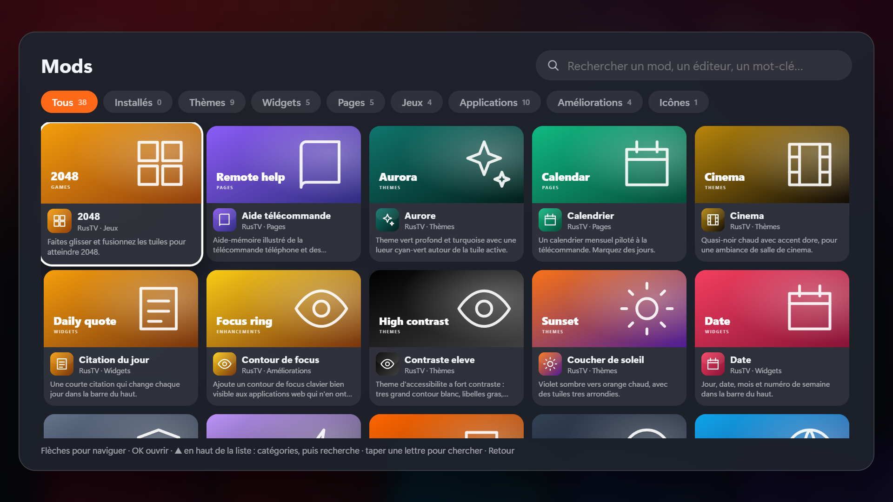
  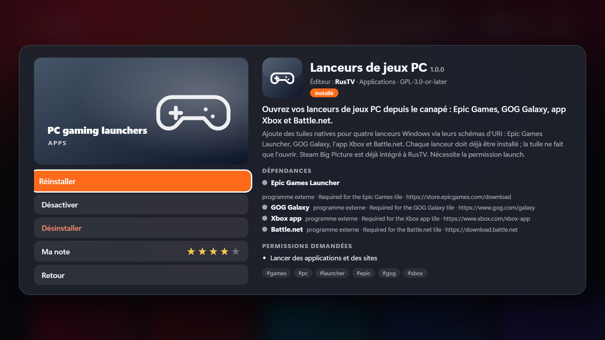

Open **Settings, Mods & extensions**. There are two tabs, **Installed** and **Online catalog**.

- **Browse**: use the category chips (All, Themes, Widgets, Pages, Games, Apps, Enhancements, Icons, Phone remote).
  Move up past the first row of cards to reach the categories and the search box.
- **Search**: by name, publisher, keyword or description (typing a letter starts a search).
- **Open a mod** to see its banner, description, publisher, dependencies and the permissions it will ask for.
- **Rate**: give it a personal star rating. It is stored only on your PC.
- **Install**: the exact permissions are shown before installing, and the mod comes from a pinned GitHub commit, so its
  content cannot change after review. Then enable it. **Disable** or **Uninstall** at any time.
- **Dependencies**: a mod can need another mod (RusTV shows whether it is installed and lets you open it) or an external
  program (for example mpv), which you install yourself.
- **Permissions**: `storage`, `launch`, `network:<origin>` and `inject:<site>`. A mod only gets what you accepted.
  Phone remote contributions need no permission because they only send commands the remote could already send.

You can also drop a mod folder in the mods folder ("Open the mods folder" in the Installed tab).

  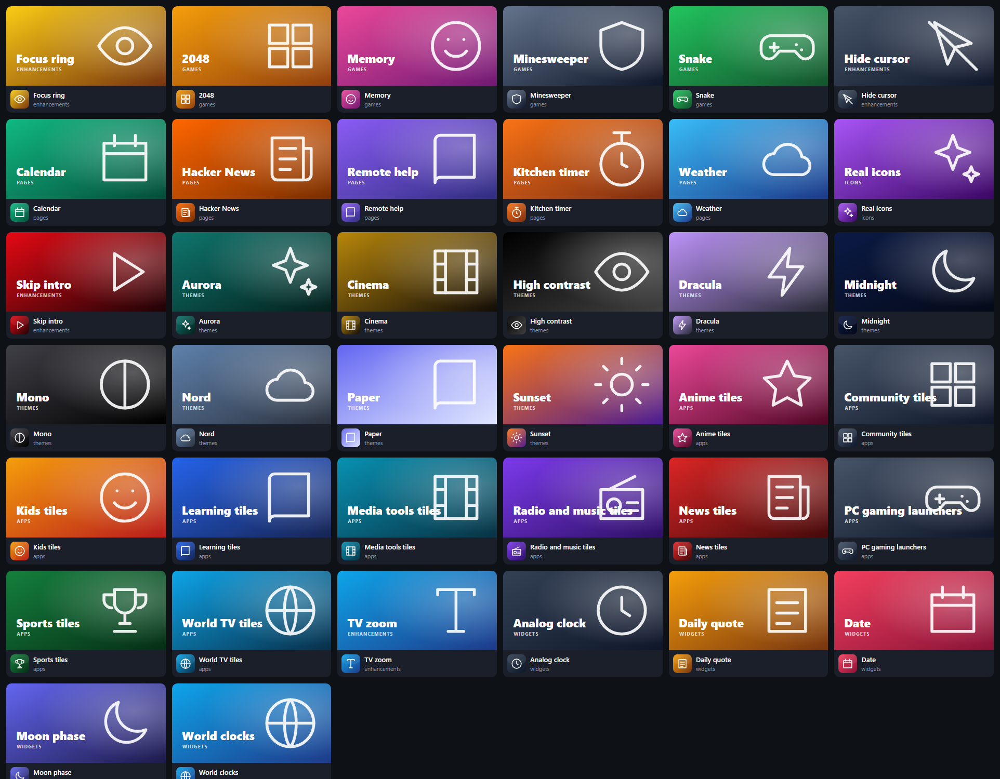

## Phone remote mods

Some mods add to the phone app itself:

- **Themes** change the remote's colors. Pick one in the remote's settings (gear). Example: the AMOLED theme.
- **Button panels** appear in the **Mods** tab of the remote: buttons that run a sequence of actions such as opening a tile,
  setting the volume, typing text or going Home. Examples: quick launch and scenes.

They are purely declarative: no code is sent to the phone. The PC sanitizes everything, and the phone checks it again.
Only enabled mods are sent.

  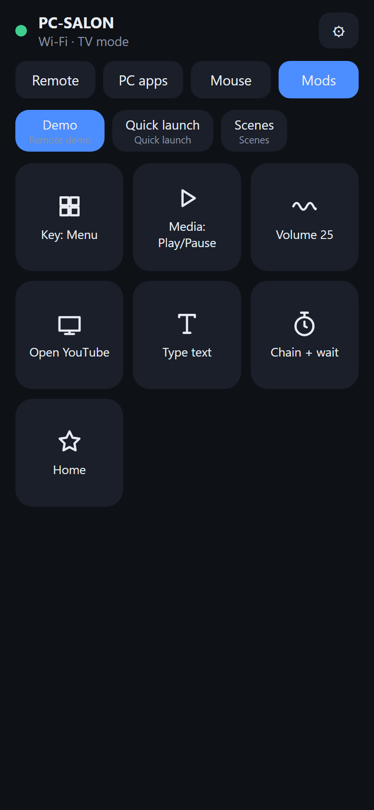
  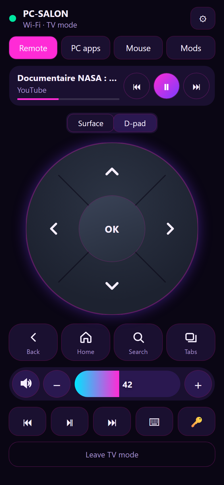
  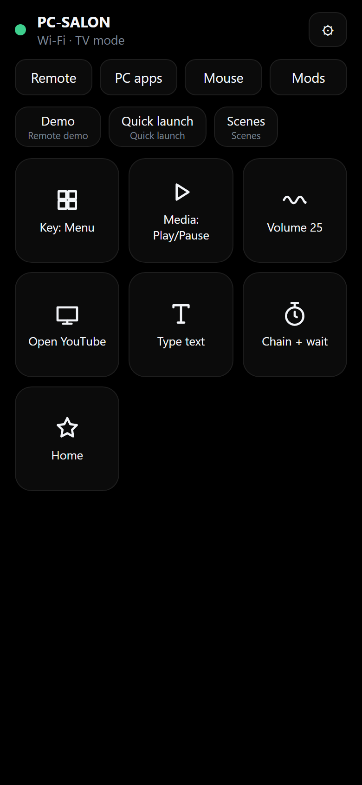

Honest status: these themes and panels were verified with the real PC protocol and a browser rendering. They have not yet
been tested on a physical phone.

## Settings

Everything is driven with the remote.

| Section | What is in it |
| --- | --- |
| Appearance | Language, theme, accent color, ambient color from the focused tile, time format, navigation sounds and their volume, interface size |
| Wallpaper | Type, file or folder, blur, darken, slideshow interval |
| Tiles | Add a website or a Windows app, category for new tiles, hidden tiles, reset |
| Weather & time | Show weather, city, unit |
| Phones & pairing | Paired phones, new QR code, revoke |
| Screens & startup | Black out other screens, start with Windows (no, notification area, straight into TV mode), change screen, leave TV mode, quit, version and update check |
| Apps | YouTube browser |
| Bitwarden | Status, account, auto-lock (1 to 30 minutes), server (Vaultwarden), log out |
| Live TV, Library | Playlists and folders |
| Mods & extensions | Mod theme, installed mods, catalog |

## Integrations and hardware

Settings, Integrations and hardware groups the optional features. Each one is documented separately and is safe by default:

- **TV guard and boot to TV**: [TV-GUARD.md](TV-GUARD.md)
- **Screen and sound** (audio output, resolution, refresh rate, HDR): [DISPLAY-AUDIO.md](DISPLAY-AUDIO.md)
- **Game controller**: [GAMEPAD.md](GAMEPAD.md)
- **Player** (tracks, resume, queue): [PLAYER.md](PLAYER.md)
- **Recording and tuners**: [LIVE-TV.md](LIVE-TV.md)
- **Ambilight (Hyperion)**: [AMBILIGHT.md](AMBILIGHT.md)
- **Home Assistant**: [HOME-ASSISTANT.md](HOME-ASSISTANT.md)
- **Cast and DLNA**: [CAST.md](CAST.md)
- **Google account** (sign in once for "Sign in with Google" in your apps, opt-in): [GOOGLE-ACCOUNT.md](GOOGLE-ACCOUNT.md)

## Updates

RusTV checks GitHub Releases for a new version (you can switch the automatic check off in Settings, Screens & startup). If
one exists, you are offered to download and install it, or to open the release page. Update the phone app by installing the
newer APK from the same release page.

## Privacy

- **No telemetry**, no account, no analytics, no server run by RusTV.
- Mod **ratings stay on your PC**.
- The phone and PC talk directly over your network with an encrypted, mutually authenticated protocol
  ([PROTOCOL.md](PROTOCOL.md)). No Internet is needed for that.
- Network use is limited to what you ask for: the streaming sites you open, the weather lookup if enabled, the mod catalog,
  the mpv download you approve, and the update check.
- Streaming apps keep their own cookies in separate per-app profiles under `%APPDATA%\RusTV\profiles`.
- The optional Google account sharing (off by default) copies your Google session cookies into the apps you allow; RusTV never sees your password. Disconnect erases them. Limits and risks: [GOOGLE-ACCOUNT.md](GOOGLE-ACCOUNT.md).

## Troubleshooting

| Problem | What to try |
| --- | --- |
| The phone cannot find the PC | Make sure both are on the same Wi-Fi (not a guest network that isolates devices) and that RusTV is running. Allow RusTV in Windows Firewall for private networks (Windows Security, Firewall, "Allow an app"); fix it there if you refused the prompt at first launch. Then pair again with a new QR code |
| Wi-Fi blocks the connection | Use Bluetooth: pair the phone and the PC in Windows Bluetooth settings first; RusTV uses it as a fallback |
| The QR scanner does not open | Allow the camera permission for RusTV Remote in Android settings |
| SmartScreen warns about the installer | Expected: the installer is not code-signed. More info, then Run anyway |
| Android refuses the APK | Allow "install unknown apps" for the app you downloaded it with. The APK is debug-signed |
| No sound, or too quiet | Check the Windows output device; the Sound shortcut opens Windows sound settings. The remote volume bar controls the default output. Navigation sounds can be turned off in Settings |
| Arrows do not work on a website | Use the **Mouse** tab as a pointer. Some pages handle keys themselves |
| A text field does not bring up the keyboard | Chrome-based pages expose text fields only with accessibility enabled. Open the keyboard by hand with its button |
| Keys do not reach an administrator window | Windows blocks this unless RusTV is also elevated. The lock screen, UAC and Windows Hello are unreachable |
| Video does not play | Accept the mpv download when asked, or install mpv yourself. Check the stream address |
| YouTube still shows ads | In Vivaldi, enable its blocker once. Or install Brave |

If it is still stuck, open an issue: <https://github.com/TisaTHor08/rustv/issues>.

## Linux

RusTV also runs on Linux (x86_64, experimental). The full page is [LINUX.md](LINUX.md); the short version:

1. Install the `.deb` (`sudo apt install ./rustv_<version>_amd64.deb`) or run the AppImage. Log out and in once.
2. Pair the phone as on Windows (the pairing window opens at first start, and also when your desktop shows no tray icon).
3. If the pairing window shows a red message about `/dev/uinput`, the phone cannot press keys yet: follow the udev rule
   and `uinput` steps in LINUX.md.
4. Install `mpv` (`sudo apt install mpv`) for playback: RusTV never downloads it on Linux.
5. For Netflix, Prime Video, Disney+ and other DRM services install Google Chrome: RusTV opens them in Chrome in app
   mode on the TV (Settings, Linux page when available; on by default).

Not available on Linux yet: game controller, TV guard, resolution and HDR switching, Bluetooth remote.

## Uninstall

- **Windows**: Settings, Apps, Installed apps, RusTV, Uninstall. Your data stays in `%APPDATA%\RusTV` (preferences, app
  profiles, mods, pairings); delete that folder for a complete removal.
- **Linux**: `sudo apt remove rustv` (the `.deb`) or delete the AppImage. Your data stays in `~/.config/RusTV`; delete that
  folder and `~/.config/autostart/rustv.desktop` for a complete removal. Secrets stay in your keyring (search for `rustv`).
- **Phone**: uninstall RusTV Remote like any Android app.
